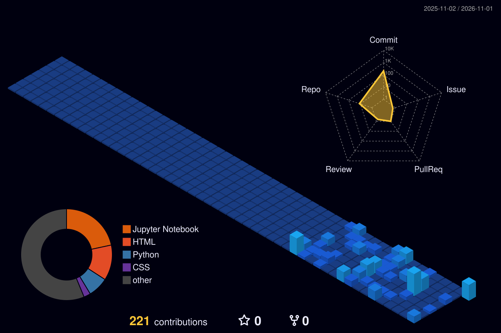

<!-- 🎬 HERO — Animated Terminal & Bio-Optic Viewfinder -->

  

 

<!-- ⚡ WHAT I BUILD & ANALYTICS PHILOSOPHY -->

  

<!-- 🪐 TECH STACK ARSENAL -->

  

<!-- 🪪 HOLOGRAPHIC LANYARD ID + LIVE DASHBOARD -->

  

## ⚡ Featured Production Projects &amp; Pipelines

<table>
<tr>
  <th>Project</th>
  <th>Architecture &amp; Description</th>
  <th>Tech Stack</th>
  <th align="center">Repository &amp; Live</th>
</tr>

<tr>
  <td>
    <a href="https://github.com/thesubhankar"><b>Thiranex Data Science Portal</b></a>
  </td>
  <td>
    Unified analytical platform integrating automated exploratory data cleaning, store sales forecasting, workforce turnover analytics, and customer churn prediction.
  </td>
  <td>
    <code>Python</code> <code>Streamlit</code> <code>Scikit-Learn</code> <code>Pandas</code> <code>Seaborn</code>
  </td>
  <td align="center">
    <a href="https://github.com/thesubhankar"><b>Code &amp; Demo</b></a>
  </td>
</tr>

<tr>
  <td>
    <a href="https://github.com/thesubhankar"><b>Movie Recommendation Engine</b></a>
  </td>
  <td>
    Content-based recommendation system parsing NLP movie metadata, vectorizing textual features with TF-IDF, and computing cosine similarity matrices via TMDb API.
  </td>
  <td>
    <code>Python</code> <code>NLP</code> <code>Scikit-Learn</code> <code>Streamlit</code> <code>TMDb API</code>
  </td>
  <td align="center">
    <a href="https://github.com/thesubhankar"><b>Code &amp; Demo</b></a>
  </td>
</tr>

<tr>
  <td>
    <a href="https://github.com/thesubhankar"><b>Fleet Telematics &amp; Logistics</b></a>
  </td>
  <td>
    End-to-end supply chain logistics telemetry suite tracking real-time fleet health, route latency anomalies, fuel consumption variance, and executive KPI dashboards.
  </td>
  <td>
    <code>Python</code> <code>Power BI</code> <code>Pandas</code> <code>SQL</code> <code>Time Series</code>
  </td>
  <td align="center">
    <a href="https://github.com/thesubhankar"><b>Code &amp; Demo</b></a>
  </td>
</tr>

<tr>
  <td>
    <a href="https://github.com/thesubhankar"><b>Supply Chain &amp; Inventory AI</b></a>
  </td>
  <td>
    Demand forecasting and safety stock modeling engine designed to minimize warehouse stockout probability, holding expense, and supplier fulfillment bottlenecks.
  </td>
  <td>
    <code>Python</code> <code>NumPy</code> <code>SciPy</code> <code>Pandas</code> <code>SQL</code> <code>Matplotlib</code>
  </td>
  <td align="center">
    <a href="https://github.com/thesubhankar"><b>Code &amp; Demo</b></a>
  </td>
</tr>

<tr>
  <td>
    <a href="https://github.com/thesubhankar"><b>Student Management Analytics</b></a>
  </td>
  <td>
    Desktop management software powered by SQLite relational database, providing student enrollment tracking, grading performance analytics, and automated transcript reporting.
  </td>
  <td>
    <code>Python</code> <code>SQLite</code> <code>Tkinter</code> <code>Pandas</code> <code>OOP</code>
  </td>
  <td align="center">
    <a href="https://github.com/thesubhankar"><b>Code &amp; Demo</b></a>
  </td>
</tr>
</table>

<a href="https://github.com/thesubhankar?tab=repositories"><b>→ Explore all public codebases &amp; analytical repositories</b></a>

  

### 🌃 3D Contribution City

*Every commit raises another analytical tower — updated automatically every day via GitHub Actions.*

  

<!-- 💌 CONNECT & COLLABORATE -->

  

 

 

**"In God we trust, all others must bring data."** ⚡ 
Designed &amp; Engineered with ❤️ by <b>Subhankar Giri</b> · © 2026

